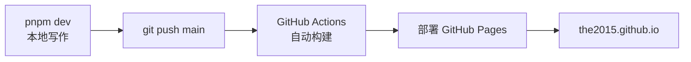

# 这篇博客是怎么部署的

记录一下本站从代码到线上访问的完整链路，以后忘了回来看。

## 整体流程



推送到 `main` 分支是唯一的手动动作，剩下的全自动。

## 关键配置

### 1. 用户主站仓库

仓库名叫 `the2015.github.io`——这是 GitHub 用户主站的约定命名，好处是访问地址就是根域名 `https://the2015.github.io`，不带子路径。

### 2. 部署工作流

`.github/workflows/deploy.yml` 核心逻辑：

1. `actions/checkout` 拉代码，`fetch-depth: 0` 拿全量提交历史（VitePress 的「最后更新于」需要 git 时间戳）
2. `pnpm/action-setup` + `actions/setup-node` 装环境，开启 pnpm 缓存
3. `pnpm install --frozen-lockfile` 安装依赖（锁文件保证构建可复现）
4. `pnpm build` 构建出静态文件
5. `actions/upload-pages-artifact` + `actions/deploy-pages` 发布

同时需要在仓库 **Settings → Pages → Build and deployment → Source** 选择 **GitHub Actions**，这一步用 API 开启即可：

```bash
gh api -X POST repos/the2015/the2015.github.io/pages \
  -f "build_type=workflow"
```

### 3. VitePress 侧的配置

- `sitemap.hostname` 指向 `https://the2015.github.io`，构建时自动生成 sitemap.xml
- `lastUpdated: true` + `fetch-depth: 0`，每篇文章底部显示最后更新时间
- `cleanUrls: true`，链接不带 `.html` 后缀

## 验证部署

推完代码到 GitHub 仓库的 **Actions** 页签看构建日志，绿勾之后访问 <https://the2015.github.io> 即可。也可以命令行查状态：

```bash
gh run list --repo the2015/the2015.github.io --limit 3
```

## 一点经验

- 构建失败先看 Actions 日志，九成是依赖或 Markdown 语法问题
- 本地先 `pnpm build` 通过再 push，能把反馈周期从几分钟缩短到几秒
- Pages 部署有缓存，改完没生效时强刷（Ctrl+F5）再确认
